  

  
  
  

  Computer Science student at <b>HIT</b>. I like projects where the interesting part is
  <i>measuring</i> whether something really works: a model, a trap, an app that has to run on a phone with no server.

---

## Selected work

<table>
<tr>
<td width="50%" valign="top">

### 🍯 [HoneyShield (Evation)](https://github.com/yanivbahalul/Evation-cyber-platform)
Active cyber-deception platform: a realistic fake careers portal that lures attackers into traps (SQLi, XSS, brute force, SSRF, honey tokens), plus a live analyst console. Team of four, I built the **admin panel, secure APIs and the attack-map / investigation dashboard**.
 `TypeScript` · `Docker` · `MongoDB` · `Socket.IO` · [demo video](https://www.youtube.com/watch?v=Cex21CGAxOY)

</td>
<td width="50%" valign="top">

### 🌙 [Riddick](https://github.com/yanivbahalul/Riddick)
Low-light image and video enhancement in PyTorch, built from scratch toward a live night camera. Multi-frame merging gives **3.55× less noise** from 72 frames at ~45 fps. The write-up includes the failures: my own benchmark was partly measuring my tuning.
 `Python` · `PyTorch` · `Raspberry Pi`

</td>
</tr>
<tr>
<td width="50%" valign="top">

### 📱 [fitness-google-sync](https://github.com/yanivbahalul/fitness-google-sync)
iOS app that syncs a fitness band from Google Health into Apple Health (**17 data types**), with a Hebrew food diary, AI meal photos and calorie balance. Fully on-device, no server.
 `Swift` · `HealthKit`

</td>
<td width="50%" valign="top">

### 🔊 [Myinstants-MacOS](https://github.com/yanivbahalul/Myinstants-MacOS)
Unofficial macOS app for myinstants.com: browse, play, favorite, upload and delete sound buttons. Ad-free and fast, with automatic upload prep and bundled ffmpeg.
 `Swift` · `macOS`

</td>
</tr>
<tr>
<td width="50%" valign="top">

### 🍜 [Noodles Simulator](https://github.com/yanivbahalul/noodles-simulator) ⭐ 25
Practice OOP questions with image-based multiple choice: live stats, minimized repeats and a global leaderboard. **Live online.**
 `C#` · [open the app](https://noodles-simulator.onrender.com)

</td>
<td width="50%" valign="top">

### 🗳️ [Election SMS Classifier](https://github.com/yanivbahalul/israeli-election-campaign-sms-classifier)
Hebrew NLP: classifies campaign SMS as political or not. Multinomial Naive Bayes implemented **from scratch** in NumPy, a balanced 10-model ensemble, train-only 5-fold CV and an untouched test split.
 `Python` · `NumPy` · `Jupyter`

</td>
</tr>
</table>

## Tech I work with

  
  
  
  
  
  
  
  
  
  
  
  

## Activity

  <picture>
    <source media="(prefers-color-scheme: dark)" srcset="https://raw.githubusercontent.com/yanivbahalul/yanivbahalul/output/github-snake-dark.svg"/>
    <source media="(prefers-color-scheme: light)" srcset="https://raw.githubusercontent.com/yanivbahalul/yanivbahalul/output/github-snake.svg"/>
    
  </picture>

---

  Let's talk · <a href="https://www.linkedin.com/in/my-linkedin-name">LinkedIn</a> · <a href="mailto:me@example.com">Email</a>

