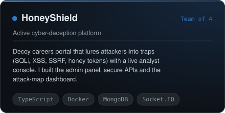
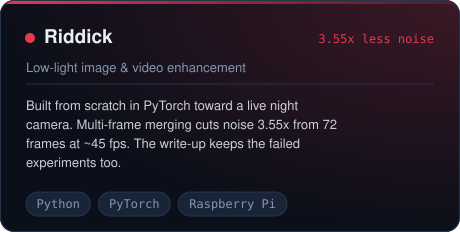
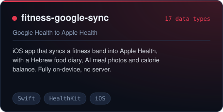
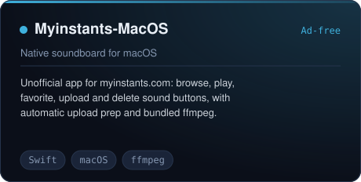
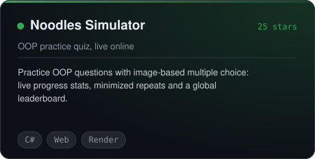
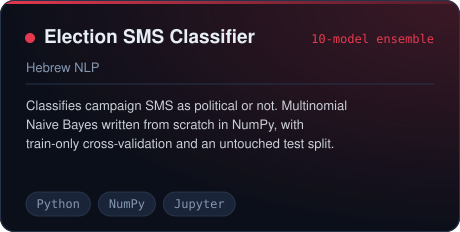

  

  
  
  

  I like projects where the interesting part is <i>measuring</i> whether something really works: 
  a model, a trap, an app that has to run on a phone with no server.

  

## Featured projects

  
  

  
  

  
  

## Stack

  

## Activity

  

  

  

